# Database design (generated)

Generated by `python manage.py generate_erd`. Do not edit by hand.

## Entity relationship diagram

```mermaid
erDiagram
  User {
    bigint id PK
    charfield email UK
    charfield phone UK
  }
  Application {
    bigint id PK
    bigint job_seeker_id FK
    bigint job_post_id FK
    bigint resume_id FK
    charfield status
  }
  ApplicationStatusHistory {
    bigint id PK
    bigint actor_id FK
    bigint application_id FK
  }
  ProjectProposal {
    bigint id PK
    bigint job_seeker_id FK
    bigint job_post_id FK
    charfield status
  }
  ProjectProposalStatusHistory {
    bigint id PK
    bigint actor_id FK
    bigint proposal_id FK
  }
  Company {
    bigint id PK
  }
  CompanyMembership {
    bigint id PK
    bigint company_id FK
    bigint employer_id FK
    charfield role
  }
  EmploymentDetail {
    bigint id PK
    bigint job_post_id FK
    charfield employment_type
    charfield required_experience_level
    charfield required_education
  }
  JobPost {
    bigint id PK
    bigint employer_id FK
    bigint company_id FK
    charfield post_type
    bigint category_id FK
    bigint province_id FK
    bigint city_id FK
    charfield work_mode
    charfield moderation_status
    charfield lifecycle_status
  }
  JobPostSkill {
    bigint id PK
    bigint job_post_id FK
    bigint skill_id FK
    charfield minimum_level
  }
  ProjectDetail {
    bigint id PK
    bigint job_post_id FK
    charfield currency
  }
  City {
    bigint id PK
    bigint province_id FK
  }
  Province {
    bigint id PK
    charfield name UK
  }
  AIMatch {
    bigint id PK
    bigint job_seeker_id FK
    bigint job_post_id FK
  }
  EmbeddingCache {
    bigint id PK
  }
  ModerationHistory {
    bigint id PK
    bigint job_post_id FK
    bigint actor_id FK
    charfield from_status
    charfield to_status
  }
  EmployerProfile {
    bigint id PK
    bigint user_id FK
  }
  JobSeekerProfile {
    bigint id PK
    bigint user_id FK
  }
  Certificate {
    bigint id PK
    bigint resume_id FK
  }
  DesiredJobTitle {
    bigint id PK
    bigint resume_id FK
    bigint job_title_id FK
  }
  Education {
    bigint id PK
    bigint resume_id FK
    charfield degree
  }
  Language {
    bigint id PK
    bigint resume_id FK
    charfield proficiency
  }
  PortfolioItem {
    bigint id PK
    bigint resume_id FK
  }
  Resume {
    bigint id PK
    bigint job_seeker_id FK
    bigint province_id FK
    bigint city_id FK
    charfield experience_level
    charfield employment_status
  }
  ResumeSkill {
    bigint id PK
    bigint resume_id FK
    bigint skill_id FK
    charfield level
  }
  WorkExperience {
    bigint id PK
    bigint resume_id FK
  }
  JobCategory {
    bigint id PK
    slugfield slug UK
    bigint parent_id FK
  }
  JobTitle {
    bigint id PK
  }
  JobTitleAlias {
    bigint id PK
    charfield normalized_text UK
    bigint job_title_id FK
  }
  JobTitleSuggestion {
    bigint id PK
    bigint suggested_by_id FK
    charfield status
    bigint reviewed_by_id FK
    bigint resulting_job_title_id FK
  }
  Skill {
    bigint id PK
  }
  SkillAlias {
    bigint id PK
    charfield normalized_text UK
    bigint skill_id FK
  }
  SkillSuggestion {
    bigint id PK
    bigint suggested_by_id FK
    charfield status
    bigint reviewed_by_id FK
    bigint resulting_skill_id FK
  }
  Application ||--o{ ApplicationStatusHistory : "application"
  City |o--o{ JobPost : "city"
  City |o--o{ Resume : "city"
  Company |o--o{ JobPost : "company"
  Company ||--o{ CompanyMembership : "company"
  EmployerProfile ||--o{ CompanyMembership : "employer"
  EmployerProfile ||--o{ JobPost : "employer"
  JobCategory |o--o{ JobCategory : "parent"
  JobCategory ||--o{ JobPost : "category"
  JobPost ||--o{ AIMatch : "job_post"
  JobPost ||--o{ Application : "job_post"
  JobPost ||--o{ JobPostSkill : "job_post"
  JobPost ||--o{ ModerationHistory : "job_post"
  JobPost ||--o{ ProjectProposal : "job_post"
  JobPost ||--o| EmploymentDetail : "job_post"
  JobPost ||--o| ProjectDetail : "job_post"
  JobSeekerProfile ||--o{ AIMatch : "job_seeker"
  JobSeekerProfile ||--o{ Application : "job_seeker"
  JobSeekerProfile ||--o{ ProjectProposal : "job_seeker"
  JobSeekerProfile ||--o| Resume : "job_seeker"
  JobTitle |o--o{ JobTitleSuggestion : "resulting_job_title"
  JobTitle ||--o{ DesiredJobTitle : "job_title"
  JobTitle ||--o{ JobTitleAlias : "job_title"
  ProjectProposal ||--o{ ProjectProposalStatusHistory : "proposal"
  Province |o--o{ JobPost : "province"
  Province |o--o{ Resume : "province"
  Province ||--o{ City : "province"
  Resume |o--o{ Application : "resume"
  Resume ||--o{ Certificate : "resume"
  Resume ||--o{ DesiredJobTitle : "resume"
  Resume ||--o{ Education : "resume"
  Resume ||--o{ Language : "resume"
  Resume ||--o{ PortfolioItem : "resume"
  Resume ||--o{ ResumeSkill : "resume"
  Resume ||--o{ WorkExperience : "resume"
  Skill |o--o{ SkillSuggestion : "resulting_skill"
  Skill ||--o{ JobPostSkill : "skill"
  Skill ||--o{ ResumeSkill : "skill"
  Skill ||--o{ SkillAlias : "skill"
  User |o--o{ ApplicationStatusHistory : "actor"
  User |o--o{ JobTitleSuggestion : "reviewed_by"
  User |o--o{ JobTitleSuggestion : "suggested_by"
  User |o--o{ ModerationHistory : "actor"
  User |o--o{ ProjectProposalStatusHistory : "actor"
  User |o--o{ SkillSuggestion : "reviewed_by"
  User |o--o{ SkillSuggestion : "suggested_by"
  User ||--o| EmployerProfile : "user"
  User ||--o| JobSeekerProfile : "user"
```

## Deletion rules (what happens when the parent row is deleted)

PROTECT = deletion is refused while children exist. CASCADE = children are deleted. SET_NULL = the link is cleared.

| Foreign key | Parent | on_delete | nullable |
|---|---|---|---|
| `AIMatch.job_post` | JobPost | CASCADE | no |
| `AIMatch.job_seeker` | JobSeekerProfile | CASCADE | no |
| `Application.job_post` | JobPost | PROTECT | no |
| `Application.job_seeker` | JobSeekerProfile | PROTECT | no |
| `Application.resume` | Resume | SET_NULL | yes |
| `ApplicationStatusHistory.actor` | User | SET_NULL | yes |
| `ApplicationStatusHistory.application` | Application | CASCADE | no |
| `Certificate.resume` | Resume | CASCADE | no |
| `City.province` | Province | PROTECT | no |
| `CompanyMembership.company` | Company | CASCADE | no |
| `CompanyMembership.employer` | EmployerProfile | CASCADE | no |
| `DesiredJobTitle.job_title` | JobTitle | PROTECT | no |
| `DesiredJobTitle.resume` | Resume | CASCADE | no |
| `Education.resume` | Resume | CASCADE | no |
| `EmployerProfile.user` | User | CASCADE | no |
| `EmploymentDetail.job_post` | JobPost | CASCADE | no |
| `JobCategory.parent` | JobCategory | PROTECT | yes |
| `JobPost.category` | JobCategory | PROTECT | no |
| `JobPost.city` | City | PROTECT | yes |
| `JobPost.company` | Company | PROTECT | yes |
| `JobPost.employer` | EmployerProfile | PROTECT | no |
| `JobPost.province` | Province | PROTECT | yes |
| `JobPostSkill.job_post` | JobPost | CASCADE | no |
| `JobPostSkill.skill` | Skill | PROTECT | no |
| `JobSeekerProfile.user` | User | CASCADE | no |
| `JobTitleAlias.job_title` | JobTitle | CASCADE | no |
| `JobTitleSuggestion.resulting_job_title` | JobTitle | SET_NULL | yes |
| `JobTitleSuggestion.reviewed_by` | User | SET_NULL | yes |
| `JobTitleSuggestion.suggested_by` | User | SET_NULL | yes |
| `Language.resume` | Resume | CASCADE | no |
| `ModerationHistory.actor` | User | SET_NULL | yes |
| `ModerationHistory.job_post` | JobPost | CASCADE | no |
| `PortfolioItem.resume` | Resume | CASCADE | no |
| `ProjectDetail.job_post` | JobPost | CASCADE | no |
| `ProjectProposal.job_post` | JobPost | PROTECT | no |
| `ProjectProposal.job_seeker` | JobSeekerProfile | PROTECT | no |
| `ProjectProposalStatusHistory.actor` | User | SET_NULL | yes |
| `ProjectProposalStatusHistory.proposal` | ProjectProposal | CASCADE | no |
| `Resume.city` | City | PROTECT | yes |
| `Resume.job_seeker` | JobSeekerProfile | CASCADE | no |
| `Resume.province` | Province | PROTECT | yes |
| `ResumeSkill.resume` | Resume | CASCADE | no |
| `ResumeSkill.skill` | Skill | PROTECT | no |
| `SkillAlias.skill` | Skill | CASCADE | no |
| `SkillSuggestion.resulting_skill` | Skill | SET_NULL | yes |
| `SkillSuggestion.reviewed_by` | User | SET_NULL | yes |
| `SkillSuggestion.suggested_by` | User | SET_NULL | yes |
| `WorkExperience.resume` | Resume | CASCADE | no |

## Database constraints

Rules the database enforces itself, whatever the application does.

| Model | Constraint | Kind |
|---|---|---|
| `AIMatch` | `matching_one_per_pair` | Unique |
| `AIMatch` | `matching_score_0_100` | Check |
| `Application` | `applications_application_post_type` | Check |
| `Application` | `applications_one_per_seeker_post` | Unique (partial) |
| `Certificate` | `resumes_certificate_dates_ordered` | Check |
| `City` | `locations_unique_city` | Unique |
| `CompanyMembership` | `companies_single_owner_per_company` | Unique (partial) |
| `CompanyMembership` | `companies_unique_member_per_company` | Unique |
| `DesiredJobTitle` | `resumes_unique_title` | Unique |
| `Education` | `resumes_education_dates_ordered` | Check |
| `EmbeddingCache` | `matching_unique_embedding` | Unique |
| `EmploymentDetail` | `jobs_employment_post_type` | Check |
| `EmploymentDetail` | `jobs_employment_salary_min_pos` | Check |
| `EmploymentDetail` | `jobs_employment_salary_range` | Check |
| `JobCategory` | `skills_category_not_own_parent` | Check |
| `JobPostSkill` | `jobs_unique_post_skill` | Unique |
| `JobPost` | `jobs_jobpost_duration_1_90` | Check |
| `JobPost` | `jobs_jobpost_id_type_uniq` | Unique |
| `JobTitleSuggestion` | `skills_jobtitlesuggestion_one_pending_per_term` | Unique (partial) |
| `JobTitle` | `skills_jobtitle_has_a_name` | Check |
| `Language` | `resumes_unique_language` | Unique |
| `ProjectDetail` | `jobs_project_budget_min_pos` | Check |
| `ProjectDetail` | `jobs_project_budget_range` | Check |
| `ProjectDetail` | `jobs_project_duration_pos` | Check |
| `ProjectDetail` | `jobs_project_post_type` | Check |
| `ProjectProposal` | `applications_one_proposal_per_seeker_post` | Unique (partial) |
| `ProjectProposal` | `applications_proposal_days_positive` | Check |
| `ProjectProposal` | `applications_proposal_post_type` | Check |
| `ProjectProposal` | `applications_proposal_price_positive` | Check |
| `ResumeSkill` | `resumes_unique_skill` | Unique |
| `Resume` | `resumes_resume_salary_positive` | Check |
| `SkillSuggestion` | `skills_skillsuggestion_one_pending_per_term` | Unique (partial) |
| `Skill` | `skills_skill_has_a_name` | Check |
| `User` | `accounts_user_email_lowercase` | Check |
| `WorkExperience` | `resumes_workexperience_dates_ordered` | Check |

Not expressible in Django and added in migrations as SQL: composite foreign keys `(job_post_id, post_type)` from `EmploymentDetail`, `ProjectDetail`, `Application` and `ProjectProposal` to `JobPost(id, post_type)`.
