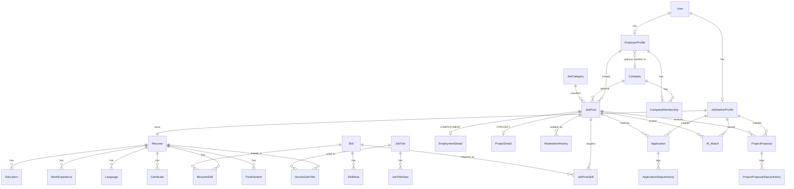

# Phase 1 — Technical Blueprint
Job Marketplace Backend (Iran)

Status: PROPOSAL — awaiting approval. No code written.

---

## 0. Repository inspection

- Working dir: empty (no manage.py, no .git, no docker-compose.yml).
- Nothing to preserve. Greenfield project.
- Sandbox has Python 3.12.3 and git. Docker is NOT available here.
- Consequence: I can write Docker files, but cannot run them here.
  Tests here run against a local PostgreSQL if installable, else I will say so.

Target layout:

```
backend/
  manage.py
  pyproject.toml
  Dockerfile
  docker-compose.yml
  .env.example
  .gitignore
  README.md
  config/
    settings/{base,dev,prod,test}.py
    urls.py  celery.py  asgi.py  wsgi.py
  apps/
    common/  accounts/  profiles/  companies/
    resumes/  skills/  jobs/  applications/
    moderation/  matching/
  docs/
  tests/   (or tests per app)
```

---

## 1. Architecture proposal

- Modular monolith, Django + DRF, PostgreSQL.
- Layering per app: `models` -> `services` -> `selectors` -> `api (views, serializers, permissions, filters)`.
- Views/serializers stay thin. Business rules live in `services.py`.
- Reads/queries with filtering live in `selectors.py`.
- Celery + Redis only for: AI embedding/matching, email (password reset).
  Redis is also used for throttling cache. Justified, so included.
- JWT: `djangorestframework-simplejwt` with blacklist app (logout/token invalidation).
- Docs: `drf-spectacular` (OpenAPI 3 + Swagger UI).
- Filtering: `django-filter`. CORS: `django-cors-headers`.
- Config: `django-environ`. Lint: Ruff. Tests: pytest, pytest-django, factory-boy.
- Package versions: pinned at Phase 2 after checking compatibility
  (Django LTS vs latest, simplejwt, spectacular). I will not guess versions now.

### Key architectural decisions

| # | Decision | Reason |
|---|----------|--------|
| D1 | Custom `User`, login by email | Required from day 1. See Q1 about phone. |
| D2 | One account, two optional profiles | Per spec. Capability = profile exists. |
| D3 | `JobPost` + `EmploymentDetail` / `ProjectDetail` (separate tables, OneToOne) | Per spec. |
| D4 | `Application` and `ProjectProposal` separate | Per spec. |
| D5 | Separate status-history tables (not generic) | See section 6. |
| D6 | Resume snapshot as JSON on Application | See section 5. |
| D7 | Moderation state separate from lifecycle state | See section 4. |
| D8 | Money as integer in Rial/Toman | See Q2. |
| D9 | Jalali dates: store Gregorian, convert in frontend | See Q3. |

---

## 2. Apps and responsibilities

| App | Owns |
|-----|------|
| common | Base abstract models (timestamps), pagination, exceptions handler, enums, validators |
| accounts | User, auth endpoints, password change/reset, deactivation |
| profiles | JobSeekerProfile, EmployerProfile |
| companies | Company, CompanyMembership |
| resumes | Resume, Education, WorkExperience, ResumeSkill, Language, Certificate, PortfolioItem, DesiredJobTitle |
| skills | Skill, SkillAlias, JobTitle, JobTitleAlias, JobCategory, SkillSuggestion, JobTitleSuggestion |
| jobs | JobPost, EmploymentDetail, ProjectDetail, JobPostSkill, search |
| applications | Application, ProjectProposal, both status-history tables |
| moderation | ModerationHistory, admin review workflow for posts |
| matching | AI_Match, embeddings, providers, scoring |

Deviation from your suggested list: `profiles` and `companies` stay separate
(as you listed). Suggestion moderation lives in `skills` (it is taxonomy-specific);
`moderation` handles job-post review only. This avoids a circular dependency.

Dependency direction (no cycles):
`common <- accounts <- profiles <- companies <- skills <- resumes <- jobs <- applications <- matching`
`moderation` depends on `jobs` and `accounts`.

---

## 3. Database ERD



### Entity notes, constraints, deletion rules

**User**
- email unique (case-insensitive: unique index on `lower(email)`), `is_active`, `is_staff`.
- Soft deactivation via `is_active=False`. Anonymization service for deletion requests.

**JobSeekerProfile / EmployerProfile**
- OneToOne to User, `on_delete=CASCADE` (profile has no meaning without the user).
- Real deletion is rare; anonymization preferred (see Q6).

**Company / CompanyMembership**
- Membership has `role` (OWNER / MEMBER), unique (company, employer).
- Exactly one OWNER at creation. Only OWNER manages members.
- EmployerProfile -> Company is expressed through Membership only (no FK on profile),
  so an employer can be in zero or many companies.
- `JobPost.company` is `SET_NULL`? No: `PROTECT`-like business rule — a company with
  posts cannot be hard-deleted; it is deactivated (`is_active`).

**Resume** (one per job seeker)
- OneToOne to JobSeekerProfile, CASCADE.
- `has_no_work_experience` boolean. Rule: if True, no WorkExperience rows allowed.
- Completeness rules (name, city, province, >=1 DesiredJobTitle, >=1 ResumeSkill)
  are enforced in `resumes.services.validate_resume_complete()` and required
  before applying to any post. Draft saving of partial resume is allowed.
- Date checks: `end_date >= start_date`, no future start for work experience,
  `CheckConstraint` in DB for date ordering.
- ResumeSkill: unique (resume, skill). DesiredJobTitle: unique (resume, job_title).
- Skill/JobTitle FK: `PROTECT` (catalogue entries are deactivated, not deleted).

**Skills catalogue**
- Skill: `name_fa`, `name_en`, `slug`, `is_active`. Unique on normalized name.
- SkillAlias: unique on normalized alias text, globally (alias cannot point to two skills).
- Normalization function (`common.text.normalize`): Persian/Arabic yeh/kaf unification,
  strip ZWNJ variations, digits normalization, lowercase, collapse whitespace.
  Stored in `normalized_name` columns with unique constraints.
- Search: `pg_trgm` + `unaccent`-style normalization for autocomplete.
- SkillSuggestion / JobTitleSuggestion: `suggested_by`, `text`, `normalized_text`,
  status (PENDING/APPROVED/REJECTED), `reviewed_by`, `reviewed_at`, `resolution_note`,
  `resulting_skill` (FK, nullable). Approve can: create a new Skill, OR map to
  an existing one as alias. Duplicate pending suggestions of same normalized text are blocked
  (partial unique index where status=PENDING).

**JobCategory**
- Hierarchical (parent nullable, max 2 levels). Admin managed.

**JobPost**
- Fields: employer (PROTECT), company (nullable, PROTECT), type, title, description,
  category (PROTECT), province, city, work_mode, moderation_status, lifecycle_status,
  published_at, expires_at, created_at, updated_at.
- Location: `province` and `city` as FKs to small reference tables
  (`common.Province`, `common.City`) loaded from fixtures. See Q4.
- Indexes: (moderation_status, lifecycle_status, published_at desc),
  (type, category), (province, city), GIN on search vector.

**Enforcing "exactly one matching detail"** (honest limits)
- DB level: OneToOne on each detail table guarantees at most one of each.
  Cross-table rule ("PROJECT must not have EmploymentDetail") cannot be a plain
  CHECK constraint in PostgreSQL across tables.
- Options: (a) constraint triggers (DEFERRABLE INITIALLY DEFERRED) via migration RunSQL,
  (b) a denormalized `post_type` column on each detail table with a composite FK
  `(job_post_id, post_type)` -> `JobPost(id, type)` plus CHECK `post_type='EMPLOYMENT'`.
- **Recommendation: (b).** Fully declarative, no triggers, portable, testable.
  Requires a unique constraint on JobPost `(id, type)`.
- "Must have a detail" (not just "must not have the wrong one") is enforced in the
  service layer inside one `transaction.atomic()`: `create_job_post()` creates post and
  detail together; API never exposes post creation without detail. Optional deferred
  trigger can be added later if you want DB-level guarantee. Flagging this as Q5.

**EmploymentDetail**
- employment_type, salary_min, salary_max, required_experience_level,
  required_education, additional_qualifications, other_conditions.
- CHECK: min > 0, max >= min.

**ProjectDetail**
- budget_min, budget_max, currency, expected_duration_days, deadline,
  expected_deliverables, additional_requirements.
- CHECK: min > 0, max >= min. Deadline must be in the future at creation (service rule).

**JobPostSkill** (through model)
- (job_post, skill, is_required, minimum_level nullable). Unique (job_post, skill).
- Used for both types, so the shared table holds required skills.
  Spec lists "required skills" in both detail models; one shared through table avoids duplication.

**Application**
- job_seeker (PROTECT), job_post (PROTECT), resume (SET_NULL, reference only),
  `resume_snapshot` JSONB, cover_letter, status, submitted_at, updated_at.
- Partial unique: (job_seeker, job_post) where status in active set
  (PENDING, REVIEWING, INTERVIEW). Re-apply allowed after REJECTED only if you want it (Q7).
- Type rule (post must be EMPLOYMENT): same composite-FK trick (`job_post_type` column)
  or service-level check. Recommend service check + a DB CHECK via composite FK
  `(job_post_id, post_type)`.

**ProjectProposal**
- job_seeker, job_post (PROJECT only), proposed_price, estimated_days, description,
  status, submitted_at, updated_at. CHECK price > 0, days > 0.
- Partial unique (job_seeker, job_post) where status in (PENDING, REVIEWING, NEGOTIATING).
- Withdraw allowed from PENDING/REVIEWING/NEGOTIATING only.

**Status history** — see section 6.

**AI_Match**
- (job_seeker, job_post) unique per (provider, model_version) set; `score` 0–100,
  `factors` JSONB, `explanation` JSONB (list of coded reasons, localizable),
  `provider`, `model_name`, `scoring_version`, `computed_at`, `is_stale`.

**ModerationHistory**
- job_post, actor, from_status, to_status, reason, created_at. Append-only.

---

## 4. Post state model

Two separate fields, as requested.

Moderation state: `DRAFT -> PENDING_REVIEW -> APPROVED | REJECTED`
Lifecycle state: `INACTIVE | ACTIVE | EXPIRED | DEACTIVATED`

Your spec lists all six values in one list. My proposal splits them:

- `moderation_status`: DRAFT, PENDING_REVIEW, APPROVED, REJECTED
- `lifecycle_status`: ACTIVE, DEACTIVATED, EXPIRED

Public visibility rule (single selector `visible_posts()`):
`moderation_status=APPROVED AND lifecycle_status=ACTIVE AND expires_at > now`.

Transitions:
- Employer: DRAFT -> PENDING_REVIEW (submit). REJECTED -> DRAFT (edit) -> PENDING_REVIEW.
- Admin: PENDING_REVIEW -> APPROVED / REJECTED (reason mandatory on reject).
- Employer: ACTIVE <-> DEACTIVATED (own post, only if APPROVED).
- Expiry: Celery beat task (or lazy check in selector) marks EXPIRED.
- Editing an APPROVED post's substantive fields sends it back to PENDING_REVIEW
  (otherwise employers could bypass moderation). Flagged as Q8.

Every transition goes through `moderation.services` and writes ModerationHistory.

---

## 5. Resume snapshot decision

Chosen: **JSON snapshot stored on Application** at submission.

Alternatives considered:
- Versioned resume tables (resume_version): heavy, doubles the schema.
- Reference only: history silently changes. Rejected.

Snapshot contains the serialized resume at that moment (personal info limited to what
the employer should see, education, experience, skills, etc.) plus `snapshot_version`
(schema version). Employers see the snapshot, not the live resume.
`Application.resume` FK remains for reference (SET_NULL).
For ProjectProposal: no resume snapshot in the spec. I propose the employer sees the
proposer's public-facing profile summary only. Flagged as Q9.

---

## 6. Status history decision

Chosen: **separate history tables** (ApplicationStatusHistory,
ProjectProposalStatusHistory) + ModerationHistory.

Why not a generic model (GenericForeignKey): no FK integrity, harder queries and
indexing, no per-domain constraints. Cost of separate tables is small (3 similar models,
one shared abstract base in `common`).

Fields: object FK, from_status, to_status, actor (SET_NULL), note, created_at.
Append-only: no update/delete via API or admin (admin read-only).
Written only inside the transition service, in the same transaction as the status change.

Permissions: job seeker sees history of own application; employer sees history for
their posts; admin sees all. Internal moderation notes are never in public serializers.

Allowed transitions (state machine dict in services; invalid -> 409/400):

Application:
`PENDING -> REVIEWING | REJECTED`, `REVIEWING -> INTERVIEW | REJECTED`,
`INTERVIEW -> ACCEPTED | REJECTED`. ACCEPTED/REJECTED terminal.
(Job seeker withdrawal of an Application is not in your spec; see Q7.)

ProjectProposal:
`PENDING -> REVIEWING | REJECTED | WITHDRAWN`,
`REVIEWING -> NEGOTIATING | ACCEPTED | REJECTED | WITHDRAWN`,
`NEGOTIATING -> ACCEPTED | REJECTED | WITHDRAWN`. Employer cannot set WITHDRAWN;
job seeker can only set WITHDRAWN.

---

## 7. Authentication and permission strategy

Auth
- JWT access (short, ~15 min) + refresh (~7 days, rotating, blacklist after rotation).
- Logout = blacklist refresh token.
- Password reset: token via Django's `PasswordResetTokenGenerator`, sent by email
  (Celery task). In dev, console email backend. Delivery channel: see Q1 (SMS in Iran).
- Throttling (DRF scopes, Redis-backed): login, register, password reset, suggestions.

Authorization (all server-side)
- Role is derived from profile existence, never from a client-sent field.
- Permission classes: `IsJobSeeker`, `IsEmployer`, `IsAdminUser`,
  object-level `IsPostOwner`, `IsApplicationParty`, `IsResumeOwner`, `IsCompanyOwner`.
- Querysets are always scoped (e.g. employer sees only `Application.objects.filter(job_post__employer=me)`),
  so foreign objects return 404 (not 403) to avoid leaking existence (IDOR protection).
- Serializers: explicit field lists only (no `__all__`), separate input/output serializers,
  read-only for status/owner/moderation fields -> no mass assignment.
- Contact info and resume: visible only to (a) owner, (b) employer who received an application
  from that seeker (via snapshot), (c) admin. Never in public job/profile serializers.
- Profile image: validate type/size, re-encode with Pillow, random filename,
  stored outside web root; served via media storage.

---

## 8. API plan (v1)

Base: `/api/v1/`. Auth: Bearer JWT unless "Public".
Errors: one shape for all errors:

```json
{ "error": { "code": "validation_error", "message": "...", "details": { "field": ["..."] } } }
```
Pagination: page-number (`page`, `page_size` max 50), response `{count,next,previous,results}`.

### Auth / accounts
| Method | URL | Auth | Notes |
|---|---|---|---|
| POST | /auth/register/ | Public | throttled |
| POST | /auth/login/ | Public | returns access+refresh |
| POST | /auth/token/refresh/ | Public | rotating |
| POST | /auth/logout/ | Auth | blacklist refresh |
| POST | /auth/password/change/ | Auth | |
| POST | /auth/password/reset/ | Public | always 200 (no user enumeration) |
| POST | /auth/password/reset/confirm/ | Public | |
| GET/PATCH | /accounts/me/ | Auth | |
| POST | /accounts/me/deactivate/ | Auth | |

### Profiles and companies
| Method | URL | Permission |
|---|---|---|
| POST/GET/PATCH | /profiles/job-seeker/me/ | Auth (creates profile on POST) |
| POST/GET/PATCH | /profiles/employer/me/ | Auth |
| POST | /companies/ | Employer |
| GET/PATCH | /companies/{id}/ | Member (GET), Owner (PATCH) |
| GET/POST/DELETE | /companies/{id}/members/ | Owner |

### Resume
| Method | URL | Permission |
|---|---|---|
| GET/POST/PATCH | /resumes/me/ | JobSeeker |
| CRUD | /resumes/me/educations/ , /work-experiences/ , /skills/ , /languages/ , /certificates/ , /portfolio/ , /desired-titles/ | Resume owner |

### Taxonomy
| Method | URL | Permission |
|---|---|---|
| GET | /skills/?search= | Auth |
| GET | /job-titles/?search= | Auth |
| GET | /categories/ | Public |
| POST | /skills/suggestions/ , /job-titles/suggestions/ | Auth, throttled |
| GET | /skills/suggestions/mine/ | Auth |
| admin: GET/POST approve, reject | /admin/skill-suggestions/{id}/approve|reject/ | Admin |

### Jobs
| Method | URL | Permission |
|---|---|---|
| GET | /jobs/ (search all published) | Public |
| GET | /jobs/employment/ , /jobs/projects/ (filtered views) | Public |
| GET | /jobs/{id}/ | Public if visible; owner/admin otherwise |
| POST | /jobs/employment/ , /jobs/projects/ | Employer |
| PATCH/DELETE | /jobs/{id}/ | Post owner |
| POST | /jobs/{id}/submit/ | Post owner |
| POST | /jobs/{id}/deactivate/ , /activate/ | Post owner |
| GET | /jobs/mine/ | Employer |

Filters: `q, category, type, province, city, work_mode, employment_type,
experience_level, salary_min/max, budget_min/max, skills (ids), published_after`.
Search: PostgreSQL full-text (`simple` config + trigram) over title+description with
normalized Persian text. No built-in Persian stemmer in PostgreSQL; trigram handles typos/forms.

### Applications / proposals
| Method | URL | Permission |
|---|---|---|
| POST | /jobs/{id}/applications/ | JobSeeker, EMPLOYMENT posts only |
| GET | /applications/mine/ | JobSeeker |
| GET | /jobs/{id}/applications/ | Post owner |
| GET | /applications/{id}/ | Party |
| POST | /applications/{id}/transition/ | Post owner |
| GET | /applications/{id}/history/ | Party |
| POST | /jobs/{id}/proposals/ | JobSeeker, PROJECT posts only |
| GET | /proposals/mine/ | JobSeeker |
| GET | /jobs/{id}/proposals/ | Post owner |
| POST | /proposals/{id}/transition/ | Owner (employer statuses) / seeker (withdraw) |
| GET | /proposals/{id}/history/ | Party |

### Matching
| Method | URL | Permission |
|---|---|---|
| GET | /matching/recommendations/ | JobSeeker |
| GET | /matching/jobs/{id}/ | JobSeeker (own score + explanation) |
| GET | /matching/jobs/{id}/candidates/ | Post owner (assistive ranking of applicants only) |
| POST | /matching/recompute/ | JobSeeker, throttled, async |

### Admin
| Method | URL |
|---|---|
| GET | /admin-api/jobs/pending/ |
| GET | /admin-api/jobs/{id}/ (full: employer info, history) |
| POST | /admin-api/jobs/{id}/approve/ , /reject/ (reason required) |
| GET | /admin-api/jobs/{id}/moderation-history/ |
| GET/POST | suggestion endpoints above |

The full per-endpoint spec (request/response examples, error codes) will be generated
in OpenAPI via drf-spectacular and exported to `docs/api/` at Phase 8.

---

## 9. AI matching architecture

Pipeline (all in `matching/`):

1. **Extract**: `extractors.py` builds a `MatchProfile` (seeker) and `MatchTarget` (post)
   dataclasses from DB rows. Structured, no LLM needed.
2. **Normalize**: skills/titles resolved to catalogue IDs through aliases.
3. **Embed**: `providers/base.py` defines `EmbeddingProvider` (`embed(texts) -> list[vector]`,
   `name`, `model`, `dim`). Implementations:
   - `HttpEmbeddingProvider` (configurable URL/key/model via env; works with multilingual models).
   - `LocalSentenceTransformerProvider` (optional extra dependency, e.g. multilingual-e5; not installed by default to keep image small).
   - `NullProvider` -> fallback.
4. **Semantic similarity**: cosine similarity.
5. **Structured score** (weighted): skill overlap (required vs optional), title match,
   experience level, education, work mode, location, salary/budget compatibility.
6. **Hard constraints**: e.g. on-site job in different province vs seeker not willing to relocate.
   They don't remove the post; they set a flag and an explanation ("possible mismatch"),
   and cap the score. Nothing is auto-rejected.
7. **Combine**: `ScoringStrategy` with weights in settings (e.g. 0.6 structured / 0.4 semantic
   when embeddings exist; 1.0 structured when not). Strategy is versioned (`scoring_version`).
8. **Explain**: coded reasons (`SKILL_OVERLAP_STRONG`, `MISSING_REQUIRED_SKILLS: [..]`,
   `WORK_MODE_COMPATIBLE`, `BUDGET_COMPATIBLE`...) + Persian text rendered from codes.

Fallback (no credentials): `NullProvider` is selected explicitly; the result is
stored with `provider="none"` and `semantic_used=false`, and the API response says so.
It is structured-only scoring, clearly labeled. No fake embeddings.

Storage of vectors: Option A: JSONB/float arrays on a `*_embedding` table, cosine in Python
(fine up to thousands of posts). Option B: `pgvector` extension (needs custom Postgres image).
**Recommendation: start with A behind a `VectorStore` interface; move to pgvector if scale needs it.** (Q10)

Async: Celery tasks `compute_embedding_for_resume/post`, `recompute_matches_for_seeker/post`;
triggered after resume/post approval changes (debounced), plus `is_stale` flag.
Disclaimers: score is "approximate compatibility indicator", never a decision;
no endpoint changes application status based on score.

---

## 10. Testing strategy

- pytest + pytest-django + factory-boy; tests in `apps/<app>/tests/`.
- Real PostgreSQL in tests (needed for partial unique indexes, GIN, trigram, JSONB).
- Layers: model constraint tests (assert `IntegrityError`), service tests (transitions),
  API tests (auth, permissions, IDOR, validation shape), selector tests (visibility).
- Mandatory negative tests (all from your list) + throttling, token blacklist,
  mass-assignment (try to send `status`, `employer`), N+1 guard via `django_assert_max_num_queries`.
- Matching: deterministic tests with a `FakeEmbeddingProvider` used ONLY in tests
  (clearly in the tests package, never in production code).
- CI-ready command: `ruff check . && ruff format --check . && pytest`.

---

## 11. Roadmap (matches your phases)

| Phase | Output | Exit criteria |
|---|---|---|
| 2 | Project, Docker, User, settings, base tests | `docker compose up` works, migrations clean, tests green |
| 3 | Auth, profiles, companies | Auth + permission tests green |
| 4 | Skills, resume | Constraint + validation tests green |
| 5 | Jobs, search, moderation | Visibility + moderation tests green |
| 6 | Applications, proposals, history | Transition + duplicate tests green |
| 7 | Matching | Pipeline tests with fake provider; fallback documented |
| 8 | QA, docs, report | Full suite, OpenAPI export, README |

---

## 12. Risks

1. Docker cannot run in my sandbox -> compose file verified only by review; you run it on your machine.
2. Cross-table type constraint (post type vs detail) is not natively expressible; composite-FK approach adds a redundant column.
3. Persian search quality in PostgreSQL FTS is limited (no stemmer). Trigram + normalization mitigates.
4. Embedding model quality/cost for Persian is unverified until a provider is chosen.
5. Sanctions/connectivity in Iran: external AI APIs and package/registry access may be blocked or unreliable. Local model option is important.
6. Email/SMS delivery for password reset in Iran (Q1).
7. Scope is large; Phases 3–6 are the real bulk.

---

## 13. Open questions (need your decision; recommended default in bold)

- **Q1** Login identifier: **email**; or Iranian mobile number (more common in Iran, needs SMS provider like Kavenegar)? I suggest email + optional unique phone field now, SMS OTP later.
- **Q2** Money: **integer, stored in Toman or Rial?** Suggest Rial as BigInteger + `currency` field (IRR default); frontend shows Toman. Is `currency` needed beyond IRR/USD?
- **Q3** Dates: **Gregorian in DB and API (ISO 8601)**; Jalali conversion in React.
- **Q4** Provinces/cities: **reference tables with fixtures** (31 provinces + cities) rather than free text. Needed for reliable filtering. OK?
- **Q5** "Must have detail" enforcement: **service layer + composite FK**; add DB deferred trigger too?
- **Q6** Account deletion: **deactivate + anonymize PII, keep applications for employer history**.
- **Q7** Re-apply after REJECTED allowed? Seeker withdraw of Application? Suggest: **re-apply blocked once REJECTED; add WITHDRAWN status to Application** (this is a small addition to your spec).
- **Q8** Editing an approved post: **substantive edit -> back to PENDING_REVIEW**.
- **Q9** Employer visibility of proposer: **name, public summary, skills, no contact info until ACCEPTED**? And contact info on ACCEPTED Application?
- **Q10** Vector storage: **JSON + interface now, pgvector later**.
- **Q11** Post expiry default: **30 days, max 90**, renewable. OK?
- **Q12** Django version: **latest LTS compatible with Python 3.12** (I will verify at Phase 2) rather than newest non-LTS, for stability. You said "latest stable"; confirm LTS is fine.
- **Q13** Employer-company: can any employer create a company, and is company verification by admin needed? Suggest **no verification in MVP, flag field `is_verified` for later**.
- **Q14** Admin interface: Django Admin only (custom actions for moderation) plus the `/admin-api/` endpoints, or only API for the React admin? Suggest **both**.

---

Waiting for approval or changes before Phase 2.
